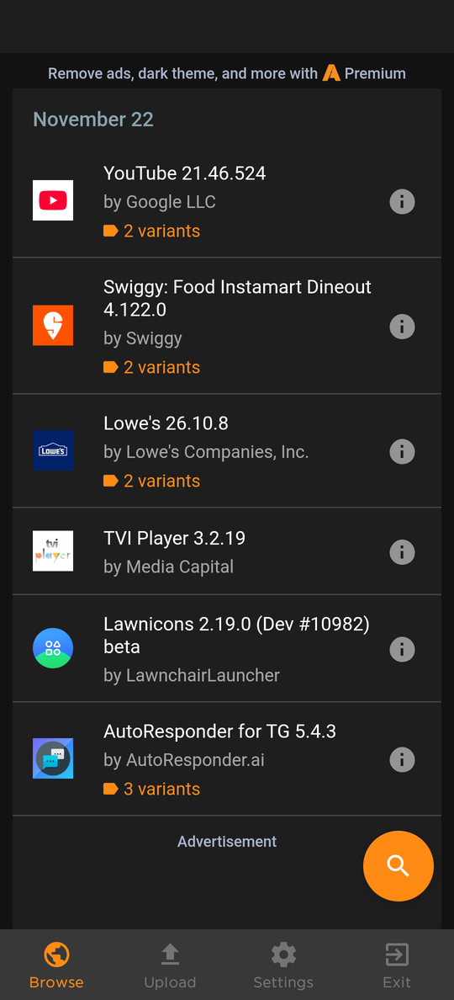
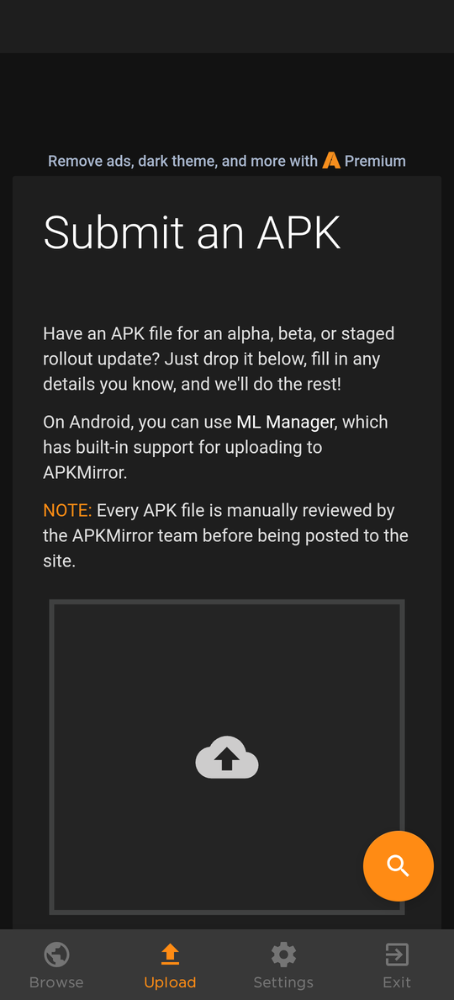
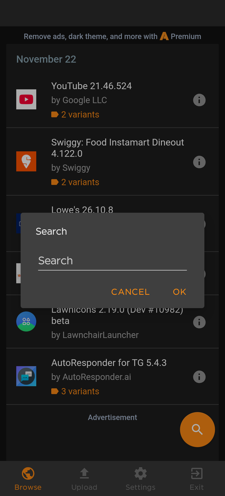
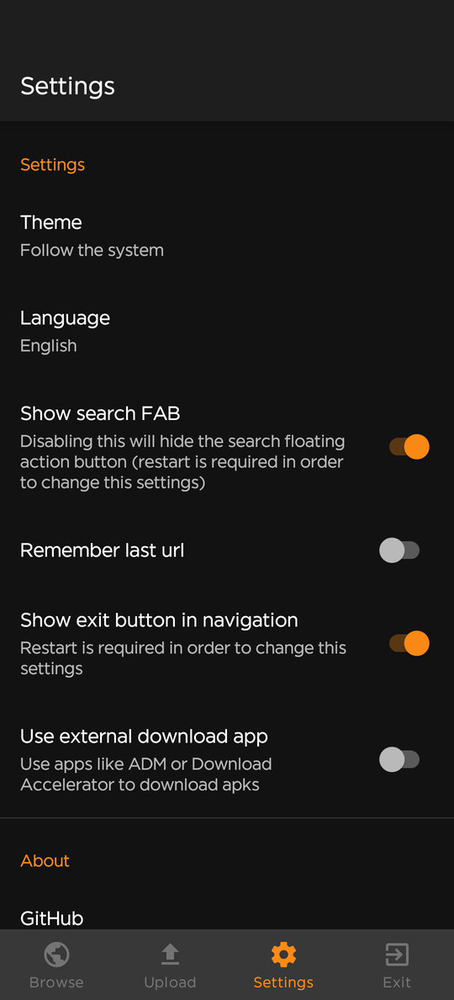
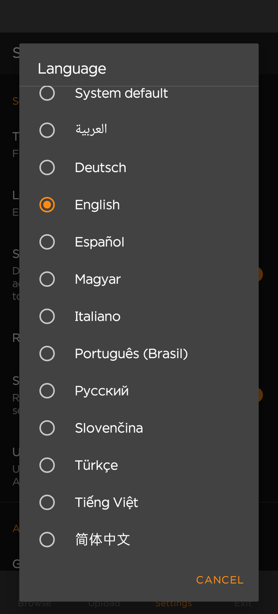
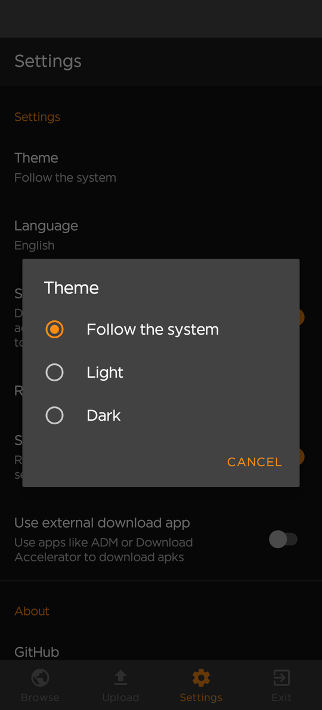

# APKMirror (dark)

An unofficial [apkmirror.com](https://www.apkmirror.com/) client for Android, now with a **dark theme**.

This is a fork by **tugaia56** of the app by [Vojtěch Hořánek](https://github.com/vojta-horanek/APKMirror) (GPL-2.0), which was abandoned in 2018. The app is a small, fast wrapper around the site: browse, search, download and upload APKs from a clean Material interface.

## What's new in this fork

- **Dark theme**: follows the system, or choose *Light* / *Dark* in Settings. The page background is `#121212`, the cards are a bit lighter (`#1E1E1E`), and the site header, the status bar and the bars of the app are dark too. The colours are all at the top of [`app/src/main/assets/dark.js`](app/src/main/assets/dark.js), easy to change.
- **Language**: choose the language of the app in Settings (Arabic, German, English, Spanish, Hungarian, Italian, Portuguese (Brazil), Russian, Slovak, Turkish, Vietnamese, Chinese). The entries of the side menu of the site are translated too.
- Rebuilt for current Android (8+): Gradle, AndroidX, Material Components, `https` instead of `http`.
- The dead libraries are gone: own WebView client, Android `DownloadManager` for downloads, Material bottom bar and dialogs, AndroidX preferences.
- New application id `it.tugaia56.apkmirror`: it installs next to the original app.

## Screenshots

    

Browse, upload, search, settings and language. The theme choice is in the settings too:



## Features

- Quick loading, clean Material design, small APK
- Search button, upload page, side menu of the site
- Downloads with the system download manager, or with an external one (ADM, Download Accelerator...)
- Remembers the last page (optional), launcher shortcuts for Upload, Search and Settings
- Opens `apkmirror.com` links

## Build

```
./gradlew assembleDebug
```

The APK is in `app/build/outputs/apk/debug/`. Needs JDK 17 and the Android SDK (compileSdk 35).

## License

```
APKMirror web app/client
    Copyright (C) 2017  Vojtěch Hořánek

    This program is free software; you can redistribute it and/or modify
    it under the terms of the GNU General Public License as published by
    the Free Software Foundation; either version 2 of the License, or
    (at your option) any later version.

    This program is distributed in the hope that it will be useful,
    but WITHOUT ANY WARRANTY; without even the implied warranty of
    MERCHANTABILITY or FITNESS FOR A PARTICULAR PURPOSE.  See the
    GNU General Public License for more details.

    You should have received a copy of the GNU General Public License along
    with this program; if not, write to the Free Software Foundation, Inc.,
    51 Franklin Street, Fifth Floor, Boston, MA 02110-1301 USA.
```

Changes of this fork: Copyright (C) 2026 tugaia56, same license (GPL-2.0).
Not affiliated with apkmirror.com.
